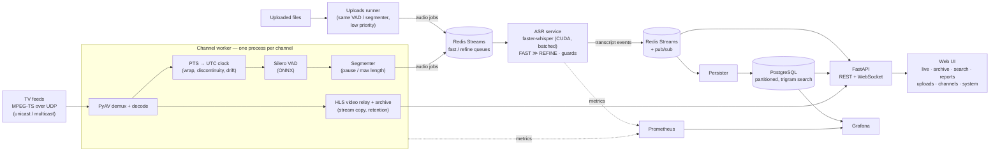

# Urdu Live TV Speech-to-Text — GPU edition

[](https://github.com/Sabeeh-Dayyan/urdu-live-stt-gpu/actions/workflows/ci.yml)
[](LICENSE)


Real-time **Urdu (and Urdu–English code-switched) speech-to-text for live television** delivered
as MPEG-TS over UDP (unicast or multicast). It produces:
- live captions within seconds, and a more careful second pass that replaces them;
- sentence-level UTC timestamps derived from the stream's own clock;
- a web player that shows the channel's video next to the transcript (click a sentence to replay
  that moment);
- a **video archive**: watch any past time range (e.g. 14:00–15:00) with its transcript, and
  download it as MP4;
- **search and topics**: find every mention of a word or a saved topic (e.g. "Prime Minister" =
  وزیراعظم, وزیر اعظم, پرائم منسٹر …), grouped into occurrences you can watch;
- **reports** for a custom time range or everything stored (HTML/PDF, Markdown, JSON);
- **file uploads**: transcribe a video or audio file and play it with a clickable transcript;
- **channel management in the browser**: add a stream URL, edit, enable or disable it;
- one **System & links** page listing every endpoint, Grafana, Prometheus and the API docs;
- exports (SRT, VTT, CSV, TXT, JSON), a REST/WebSocket API, and Grafana dashboards with live and
  measured accuracy metrics.

**This is the GPU edition**: CUDA image, batched inference across channels, and streaming
(LocalAgreement-2) mode for low latency on NVIDIA GPUs. It needs a Linux server with an NVIDIA GPU.
Without a GPU, use the CPU edition: **[urdu-live-stt-cpu](https://github.com/Sabeeh-Dayyan/urdu-live-stt-cpu)**.

> **Status:** the GPU code path is built and its Docker image is tested (it builds, starts, and
> falls back to CPU when no GPU is visible). **GPU speed, latency and channels-per-GPU have not been
> measured yet.** All numbers below are from the CPU development machine. Measure on your GPU
> with the commands in [docs/DEPLOYMENT.md §8](docs/DEPLOYMENT.md#8-measure-on-your-hardware).

## Architecture



* **Two passes.** FAST (`large-v3-turbo`, greedy) gives live text. REFINE (beam 5, ±0.5 s context;
  `large-v3` on GPU) replaces it in place.
  FAST is never delayed by REFINE. Under load REFINE is skipped and flagged `refine_skipped`, never
  silently.
* **Timestamps** come from the stream PTS anchored to the host clock (NTP). They handle 33-bit
  wraparound, discontinuities (encoder resets, loops) and gradual drift correction.
* **Hallucination guards:** no-speech/log-probability, compression ratio, repetition, boilerplate
  blocklist (e.g. "موسیقی" on music), word-range clamping.
* **Reliability:** every component restarts with backoff. Bus messages are at-least-once and
  database writes idempotent. The video relay can never stop transcription.

Every design decision, with the measurement behind it, is in
[docs/ARCHITECTURE.md](docs/ARCHITECTURE.md).

## Measured results

All numbers below were produced by the repo's own tools (`stt bench`, `stt bench-live`,
`bench/calibration.py`, `make soak`) on an **Intel i9-9980HK (8 cores) CPU, int8**. Raw results
are in [`bench/results/`](bench/results) and the full tables in [docs/BENCHMARKS.md](docs/BENCHMARKS.md).
Accuracy is measured against hand-made reference transcripts of **read Urdu speech** (Google FLEURS);
spontaneous broadcast speech is harder and its reference set is still being prepared.

### Accuracy and speed (offline, 300 s reference programme)

| Configuration | WER | CER | Real-time factor | Notes |
|---|---|---|---|---|
| **large-v3-turbo int8, greedy, 10 s segments, packing** (live FAST) | **23.8 %** | **12.9 %** | **0.90** | used in production configs |
| large-v3-turbo int8, greedy, 8 s segments, packing | 23.3 % | 12.8 % | 0.95 | |
| large-v3-turbo int8, beam 5 | 23.7 % | 12.9 % | 1.00 | REFINE on CPU |
| large-v3 int8, beam 5 | 23.8 % | 16.2 % | 1.27 | no accuracy gain over turbo on this set |

WER/CER after Urdu normalisation; run-to-run spread ≈ ±2 points. Real-time factor < 1 means faster
than real time.

### Model comparison (FLEURS Urdu test, 100 utterances decoded one by one, int8 beam 5)

| Model | WER | CER | SER | RTF (CPU) |
|---|---|---|---|---|
| Urdu fine-tune `kingabzpro/whisper-large-v3-urdu` | 19.45 % | 7.97 % | 96 % | 3.55 |
| **`large-v3`** (GPU REFINE + uploads) | **19.95 %** | **7.70 %** | 95 % | 2.62 |
| `large-v3-turbo` | 21.14 % | 8.29 % | 98 % | 1.40 |

The fine-tune's gain over large-v3 is within noise (paired bootstrap, docs/BENCHMARKS.md), so the
pinned stock model is used. SER is near 100 % for every model because the FLEURS reference spelling differs
from the model's spelling; see [docs/MODELS.md](docs/MODELS.md).

### What the confidence numbers mean (calibration)

The UI and dashboards show **model confidence** (mean word probability). Measured against the
references, it means:

| Word confidence | share of words | of those, correct |
|---|---|---|
| all words | 100 % | 82.2 % |
| ≥ 90 % | 86.1 % | 88.8 % |
| ≥ 95 % | 77.7 % | 91.3 % |
| < 90 % (underlined in the UI) | 13.9 % | 41.0 % |

Filtering whole sentences by confidence barely changes accuracy (80.4 % → 80.5 % at ≥ 90 %), so
confidence is **not** a substitute for measured accuracy.

### Live latency (full system over UDP, one channel)

| Metric | p50 | p95 |
|---|---|---|
| end of speech → live text (read-speech programme, 420 s) | 13.6 s | 22.2 s |
| end of speech → live text (live Urdu TV news, short sample) | 15.8 s | — |
| end of speech → refined text (read speech) | 110.6 s | 178.1 s |

Latency on CPU is dominated by segment length (10 s) and inference time. Lower latency needs a GPU
and streaming mode (see the GPU edition); **on GPU it has not been measured yet**.
### Robustness

| Test | Result |
|---|---|
| Hallucination on music / noise / silence fed straight to the model (23 clips) | 23/23 without guards → **0/23** with guards |
| 4.5 h soak, looping programme with a timestamp reset every loop | 0 crashes or restarts, **0 lost segments** (1 868 emitted, 1 867 done, 2 in flight at stop). Worker/persister/API memory flat; ASR memory +≈130 MB/h (open issue) |
| Clock | median drift −50 ms; re-anchors on every discontinuity |
| Word timestamps vs true speech onsets (file input) | 0.13–0.21 s |
| Automated tests | 201 unit + integration tests (property-based, real Redis/Postgres, real ffmpeg streams, live UDP, real model end-to-end) |

### Capacity

Not measured on GPU yet. The planning rule (docs/RUNBOOK.md §8) is: GPUs ≈ channels × speech density ×
measured RTF ÷ 0.7. Measure RTF on your GPU first.

## Quick start: live server (Docker)

```bash
git clone https://github.com/Sabeeh-Dayyan/urdu-live-stt-gpu.git
cd urdu-live-stt-gpu/deploy
cp .env.example .env && nano .env      # set the three passwords/tokens
docker compose up -d --build           # downloads pinned models on first start
```

Then add a channel (API token from `.env`):

```bash
curl -X POST localhost:8000/channels -H "Authorization: Bearer $STT_API_TOKEN" \
  -H 'content-type: application/json' \
  -d '{"id":"news1","name":"News 1","url":"udp://@239.10.10.5:5000","audio_track":{"language":"urd"}}'
```

Open `http://SERVER:8000` (live text and video) and `http://SERVER:3000` (Grafana, user `admin`).
**Read [docs/DEPLOYMENT.md](docs/DEPLOYMENT.md)** before going live: requirements, kernel UDP
buffers, security, backups, upgrades, and running without Docker (systemd).

## Quick start: development / laptop

Prereqs: Python 3.11, ffmpeg, Docker.

```bash
make env          # .venv + pinned dependencies (uv.lock)
make models       # pinned, SHA-256-verified models
make infra        # dev Postgres, Redis, Prometheus, Grafana (localhost only)
make reference    # (optional) rebuild the FLEURS reference programme
make test         # unit + integration tests
make testbed      # terminal 1: loops a test programme to udp://127.0.0.1:5101
make run          # terminal 2: everything (or `make up` to run detached)
open http://localhost:8000
```

## Using it

| Feature | How |
|---|---|
| Live text + video | `http://SERVER:8000`: sentence timestamps, click a sentence to play the video from that moment, **LIVE** returns to the live edge. Confidence filter (default ≥ 90 %), low-confidence words underlined |
| Watch a time range | **Archive & search** page: channel + date + from/to → video and transcript side by side, click any sentence to seek, download the video (MP4/TS) and transcript. API: `GET /hls/{id}/archive.m3u8?from=&to=`, `GET /channels/{id}/clip?from=&to=&format=mp4`, `GET /channels/{id}/video/coverage`. Video is kept `relay.archive_hours` (default 24 h on servers) |
| Find a speech / topic | same page: words (`a \| b`) or a saved topic from `config/topics/topics.yaml`; hits a few minutes apart are grouped into occurrences with a **Watch** button. API: `GET /search?q=…&topic=…&from=&to=&channel=` → `results` + `clusters` |
| Reports | **Reports** page: channel(s) or an uploaded file, custom period or *overall*, optional full transcript → HTML (print to PDF), Markdown or JSON. API: `GET /reports?channel=&from=&to=&format=html\|md\|json&transcript=true&topics=` |
| Upload a file | **Upload video** page (drag and drop) or `curl -T clip.mp4 -H "Authorization: Bearer $STT_API_TOKEN" "http://SERVER:8000/uploads?filename=clip.mp4"`. Transcribed with the REFINE decoder after live work; viewer with clickable transcript, exports, report |
| Channels | **Channels** page: add a stream URL (udp, rtp, srt, rtsp, rtmp, http(s)/HLS), edit, enable/disable, delete; the worker follows within ~10 s. API: `GET/POST /channels`, `PATCH/DELETE /channels/{id}` |
| Everything in one place | **System & links** page: process status, ASR queues, links to Grafana, Prometheus, Swagger/ReDoc, and a clickable list of every API endpoint (read live from OpenAPI) |
| Export | buttons per channel, or `GET /channels/{id}/export?format=srt\|vtt\|csv\|txt\|json&from=&to=&min_conf=&tz=Asia/Karachi` |
| Live events | `WS /ws/live?channels=a,b` (`partial` / `final` / `refined` / `refine_skipped`, keyed by `segment_id`) |
| Transcripts | `GET /channels/{id}/transcripts?from=&to=&pass=&min_conf=` (each row has `confidence` and `sentences[]`) |
| Changes need the token | channel changes, uploads and deletions need `Authorization: Bearer <STT_API_TOKEN>`; in the browser press 🔑 in the top bar once |
| Health / metrics | `GET /health`, Prometheus metrics per process |
| Grafana | *Live STT* dashboard: embedded player, transcript table (click → video), live and range confidence, measured accuracy, latency, queues, RTF, stream health, clock drift. Every panel has an (i) explanation |

## Configuration

`config/default.yaml` ← profile (`config/prod-gpu.yaml` for servers, `config/dev-mac-cpu.yaml` for a laptop)
← environment variables `STT_<SECTION>__<KEY>` (e.g. `STT_ASR__CPU_THREADS=16`). Unknown keys are
rejected. `./stt show-config -c <profile>` prints the merged result.

## Repository layout

```
src/live_stt/   ingest/ (PyAV source, PTS clock, ring buffer, HLS relay, archive)  vad/  streaming/
                asr/ (service, scheduler, guards, backends/)  bus/  store/ (SQL migrations, persister)
                api/  text/ (normalisation, sentences, confidence)  reports.py  uploads.py
                models.py  supervisor.py  cli.py
ui/             live, archive & search, reports, uploads, channels, system pages (no build step)
deploy/         docker-compose.yml (server stack), .env.example, prometheus/, grafana/
config/         default.yaml + profiles, topics/topics.yaml, glossary, hallucination blocklist
infra/          Grafana dashboard + dev provisioning
bench/          benchmark, calibration, live latency, soak tools; results/ (measured JSON)
testbed/        UDP test senders, FLEURS reference set (CC-BY-4.0)
tests/          unit (incl. property-based) + integration
docs/           ARCHITECTURE · BENCHMARKS · DEPLOYMENT · RUNBOOK · PLAN (status)
```

## Known limitations

* Accuracy is measured on read speech: WER ≈ 20–24 % depending on model and segmentation.
  Broadcast speech (music beds, crosstalk, code-switching) will be worse until measured with
  broadcast references. The best open Urdu fine-tune tested did not measurably beat large-v3
  (docs/MODELS.md). Other models can be converted with `scripts/convert_whisper.py`.
* Without punctuation from the model, sentence boundaries are estimated from pauses.
* "Find the Prime Minister's speech" works by **words** (topics), not by recognising the voice:
  speaker identification is not implemented.
* On a CPU server, uploaded files share the CPU with live channels (live keeps priority, so a
  long upload can take several times its duration while a channel is running).
* ASR memory growth over long CPU runs (+≈130 MB/h) is not yet explained (see DEPLOYMENT.md §7).
* The 4.5 h soak is not the 24 h target.

## License

MIT, see [LICENSE](LICENSE). Third-party components and data: [THIRD_PARTY_NOTICES.md](THIRD_PARTY_NOTICES.md).
